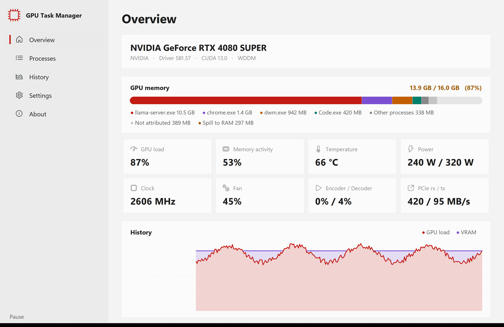
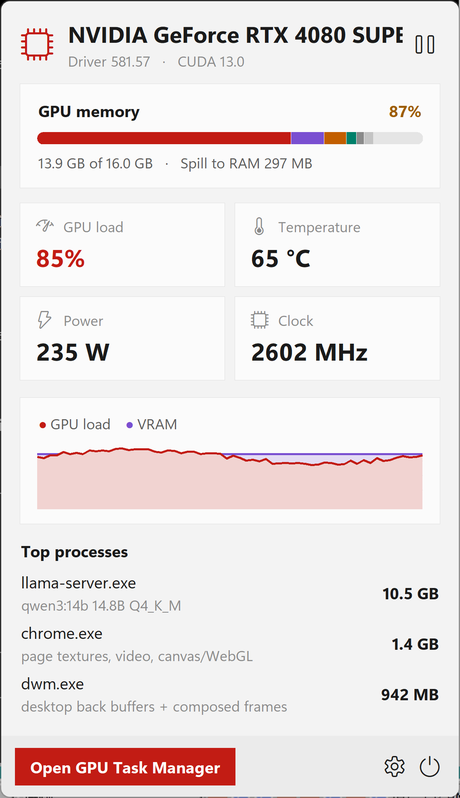
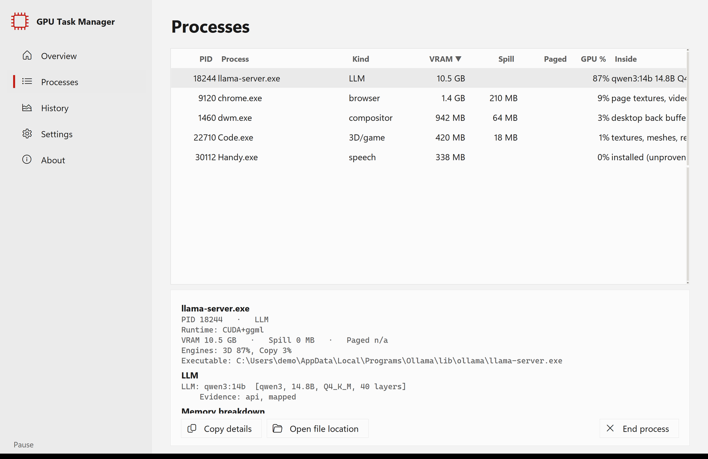
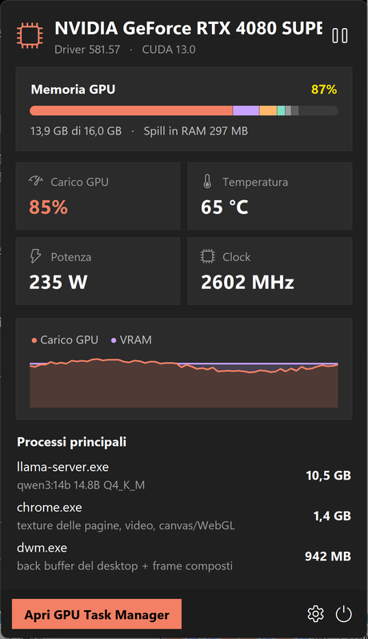
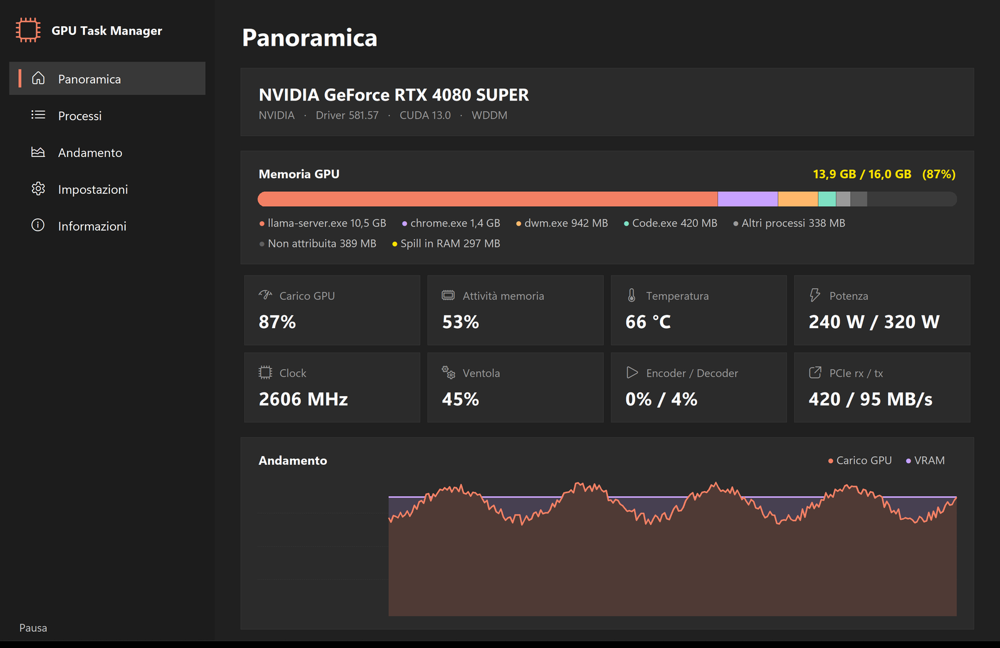
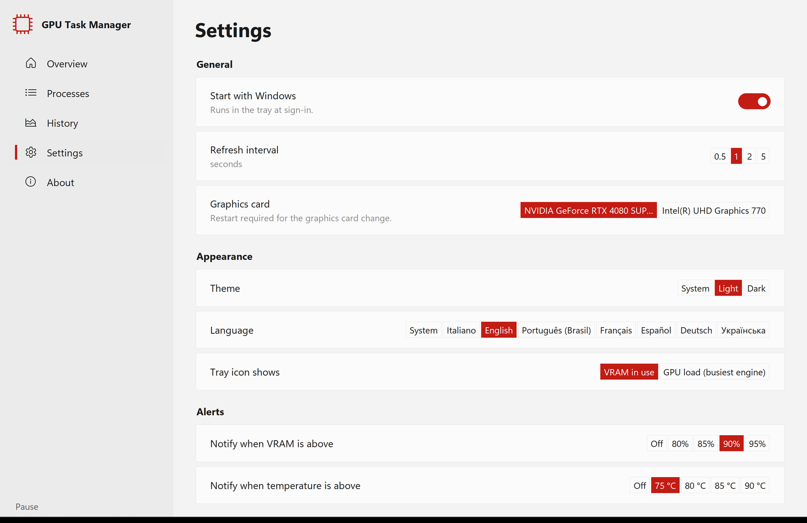

<p align="center">
  
</p>

<h1 align="center">GPU Task Manager</h1>

<p align="center"><strong>See what is inside your GPU.</strong><br>
VRAM per process, engine load, spill to RAM and, for local AI models, which model, quantization and KV cache.<br>
A Windows 11 style tray app, one click away.</p>

<p align="center">
  
  
  <a href="LICENSE"></a>
  
</p>

<p align="center">
  <a href="#see-the-app">Screenshots</a> ·
  <a href="#what-it-shows">Features</a> ·
  <a href="#build-and-install">Build and install</a> ·
  <a href="#license">License</a> ·
  <a href="#italiano">Italiano</a>
</p>

## See the app

<table>
  <tr>
    <td width="68%" align="center"><strong>Overview</strong></td>
    <td width="32%" align="center"><strong>Quick panel from the tray</strong></td>
  </tr>
  <tr>
    <td align="center"><a href="assets/readme/overview-light.png"></a></td>
    <td align="center"><a href="assets/readme/flyout-light.png"></a></td>
  </tr>
  <tr>
    <td align="center"><strong>Processes, with what each model is made of</strong></td>
    <td align="center"><strong>Dark theme · Italiano</strong></td>
  </tr>
  <tr>
    <td align="center"><a href="assets/readme/processes-light.png"></a></td>
    <td align="center"><a href="assets/readme/flyout-dark.png"></a></td>
  </tr>
</table>

<details>
<summary><strong>More: dark overview, settings and languages</strong></summary>

<p><a href="assets/readme/overview-dark.png"></a></p>
<p><a href="assets/readme/settings-light.png"></a></p>

</details>

<sub>Screenshots use the built-in demo data (<code>scripts/preview_ui.py</code>), so no real machine's processes are shown.</sub>

## What it shows

- **Tray icon that is a gauge.** A chip that fills with the VRAM in use (or the GPU load): blue, amber from 80%, red from 92%. The tooltip has the numbers.
- **Right click: quick panel.** VRAM split by process, GPU load, temperature, power, clock, the last minute and the heaviest processes.
- **Left click: main window**, laid out like Windows 11 Settings:
  - **Overview:** card and driver, VRAM bar per process, eight live metrics, five-minute history. Memory that Windows does not charge to any process is shown as *Not attributed* rather than hidden.
  - **Processes:** sortable table and an inspector for the selected process: model, quantization, memory breakdown (weights, KV cache, buffers), local server, and the evidence behind each claim. Copy details, open file location, end process.
  - **History:** GPU load, VRAM, temperature, power.
  - **Settings:** start with Windows, interval, graphics card, theme, language, tray metric, alert thresholds.
  - **About:** export a JSON snapshot, copy a text report, licences, log folder.
- **Local AI models, named.** llama.cpp, Ollama and LM Studio models are read from GGUF headers, mapped files and the local server API. For runtimes that read the model and close the file (faster-whisper / CTranslate2, PyTorch, ONNX Runtime) the app gives a clearly labelled **estimate**: a model named in the process's command line, environment or source code, or, where sizes are comparable, the one that fits the VRAM. It never presents a guess as a measurement.
- **Alerts** when VRAM or temperature cross a threshold, once per crossing.
- **Light, dark or system theme**, following Windows live. **7 languages:** English, Italiano, Português (Brasil), Français, Español, Deutsch, Українська.
- **One copy only:** a second launch brings the running window forward.

**Private by design.** No telemetry, no account, no cloud. The only network traffic is to `127.0.0.1`, to ask local model servers what they have loaded.

## Build and install

There is no signed release yet: build it from source on Windows. You need [uv](https://docs.astral.sh/uv/) and, for the installer, [Inno Setup 6](https://jrsoftware.org/isinfo.php).

```powershell
winget install --id astral-sh.uv --exact
winget install --id JRSoftware.InnoSetup --exact
git clone https://github.com/Bottega-Alu/gpu-task-manager
cd gpu-task-manager
.\scripts\build.ps1
```

| Output | What |
|---|---|
| `dist\GPUTaskManager\GPUTaskManager.exe` | portable app, no console |
| `installer\Output\GPUTaskManager-Setup-<version>.exe` | per-user installer, no admin rights |
| `installer\Output\SHA256SUMS.txt` | installer checksum |

Options: `-SkipTests`, `-NoInstaller`, `-CertThumbprint <sha1>` to Authenticode-sign the exe and the installer (without a signature Windows SmartScreen warns on first run).

The installer copies the app to `%LOCALAPPDATA%\Programs\GPUTaskManager`, adds a Start menu shortcut, offers start at sign-in and closes a running copy on update. Uninstalling also removes the sign-in entry. Settings and the log stay in `%APPDATA%\GPU Task Manager`.

**Supported:** Windows 10/11 with WDDM drivers. Validated on NVIDIA; AMD and multi-GPU work within the limits of the measurement engine.

## Development

```powershell
uv sync --group dev
uv run python -m pytest -q                                   # unit tests plus a real-UI test on demo data
uv run python scripts\preview_ui.py                          # the full UI on demo data, no GPU needed
uv run python scripts\preview_ui.py --shots .\shots --theme dark --lang de   # a screenshot of every surface
$env:PYTHONPATH="src"; uv run python -m gtm_desktop          # the real app, on your GPU
```

| Module (`src/gtm_desktop/`) | Role |
|---|---|
| `brand.py` | the **one place** for name, version, author, links, GUID and technical names |
| `app.py` | orchestration: Tk on the main thread, sampler and tray on their own threads, one queue between them |
| `sampler.py` | thread that owns the engine's `Collector` and publishes immutable `Frame`s |
| `model.py` | view model, formatting, history, alerts with hysteresis, process inspector |
| `estimate.py` | labelled model estimate for runtimes that leave no OS evidence |
| `tray.py` / `winicon.py` / `art.py` | native Win32 tray icon (`Shell_NotifyIconW` via `ctypes`), icons, notifications |
| `flyout.py` / `window.py` | quick panel and main window |
| `fluent.py` / `charts.py` | Windows 11 look, switches, Canvas charts |
| `i18n.py` | the seven UI languages; a test keeps every table complete |
| `settings.py` / `autostart.py` / `single_instance.py` | atomic settings, start at sign-in, single instance |

`ops/vram-residual-monitor/` is a diagnostic tool that logs the VRAM no process accounts for, with the events around it.

### Measurement engine

Measurements come from [**gputaskman**](https://github.com/shanselman/gputaskman) by **Scott Hanselman** (MIT), included unmodified in `src/gputaskman/`. Thanks to him: this app is a Windows desktop front end on top of his work. Update it with:

```powershell
.\scripts\sync_upstream.ps1          # latest main, or -Ref <tag|commit>
uv run python -m pytest -q
```

The script stops if the upstream licence is no longer MIT. The vendored commit is recorded in `UPSTREAM.md`.

## License

**GPU Task Manager** is © 2026 [Francesco Trani](https://francescotrani.com), licensed under the **[PolyForm Noncommercial License 1.0.0](LICENSE)**.

- ✅ **Free** for personal and home use, hobby projects, study, research, education and non-profit organisations.
- 💼 **Commercial use** (in a company, as part of a paid product or service) needs a separate licence: contact the author at [francescotrani.com](https://francescotrani.com).
- 📌 **If you copy, fork or redistribute it**, you must keep the licence and the `Required Notice:` lines in [NOTICE](NOTICE) with it, which credit the software and its author.

This is a *source-available* licence, not an OSI open-source one. Third-party code keeps its own licence: `src/gputaskman/` is MIT (Scott Hanselman), and every component bundled in the Windows build is listed in `THIRD-PARTY-NOTICES.txt`, generated by the build. All bundled dependencies are under permissive licences. This section is a summary, not legal advice; the [LICENSE](LICENSE) text is what applies.

## Author

**Francesco Trani** · [francescotrani.com](https://francescotrani.com) · part of [Bottega-Alu](https://github.com/Bottega-Alu)

If GPU Task Manager is useful to you, leave a ⭐ and tell someone who runs local models.

---

## Italiano

**GPU Task Manager** mostra cosa c'è dentro la GPU: VRAM per processo, carico dei motori, spill in RAM e, per i modelli AI locali, quale modello, quantizzazione e KV cache. È un'app per l'area di notifica di Windows in stile Windows 11.

- **Clic destro** sull'icona: pannello rapido. **Clic sinistro**: finestra principale (Panoramica, Processi, Andamento, Impostazioni, Informazioni).
- Riconosce i modelli di llama.cpp, Ollama e LM Studio. Per faster-whisper, PyTorch e ONNX Runtime dà una **stima** dichiarata come tale.
- Nessuna telemetria e nessun cloud: l'unico traffico di rete va a `127.0.0.1`.
- 7 lingue, tema chiaro/scuro, avvisi su VRAM e temperatura.

**Licenza:** PolyForm Noncommercial 1.0.0. Gratis per uso personale e domestico, studio, ricerca, scuola e no-profit. Per l'uso commerciale serve una licenza a parte: contatta l'autore su [francescotrani.com](https://francescotrani.com). Chi copia, forka o ridistribuisce deve conservare la licenza e le righe `Required Notice:` del file [NOTICE](NOTICE), che citano il software e l'autore.

Per compilare: vedi [Build and install](#build-and-install).
